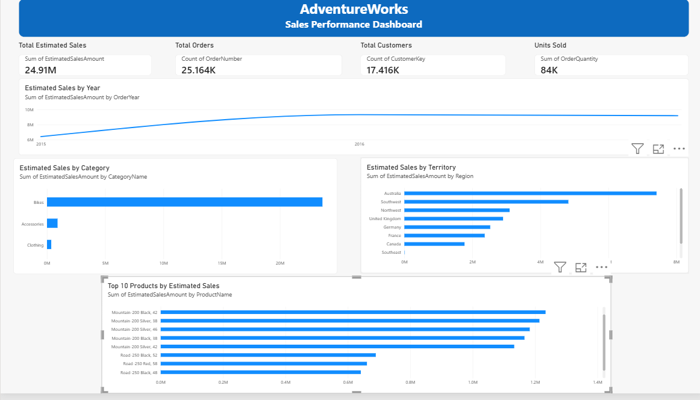

# Azure End-to-End Data Engineering Project

An end-to-end cloud data engineering project built using Microsoft Azure and the AdventureWorks dataset. This project demonstrates data ingestion, transformation, analytical data processing, and visualization using Azure Data Factory, Azure Data Lake Storage Gen2, Azure Databricks, PySpark, Azure Synapse Analytics, and Power BI.

## Project Overview

The objective of this project is to build an end-to-end data pipeline that transforms raw business datasets into structured, analytics-ready data following the **Medallion Architecture (Bronze, Silver, and Gold)**.

The pipeline processes AdventureWorks sales, customer, product, calendar, returns, and territory data to support business analysis and reporting.

## Architecture

```text
AdventureWorks CSV Files
          |
          v
Azure Data Factory (ADF)
   Data Ingestion
          |
          v
Azure Data Lake Storage Gen2
      Bronze Layer
      Raw Data
          |
          v
Azure Databricks + PySpark
      Silver Layer
 Transformed Parquet Data
          |
          v
Azure Synapse Analytics
       Gold Layer
        SQL Views
          |
          v
       Power BI
 Reports & Dashboards
```

## Technology Stack

| Technology | Purpose |
|---|---|
| Azure Data Factory | Data ingestion and pipeline orchestration |
| Azure Data Lake Storage Gen2 | Cloud storage for raw and processed data |
| Azure Databricks | Distributed data processing |
| Apache Spark / PySpark | Data transformation |
| Parquet | Columnar storage for processed datasets |
| Azure Synapse Analytics | SQL-based analytical data access |
| Power BI | Data visualization and reporting |
| Git and GitHub | Version control and project documentation |

## Dataset

The project uses the AdventureWorks dataset, which includes the following CSV files:

- `AdventureWorks_Calendar.csv`
- `AdventureWorks_Customers.csv`
- `AdventureWorks_Product_Categories.csv`
- `AdventureWorks_Product_Subcategories.csv`
- `AdventureWorks_Products.csv`
- `AdventureWorks_Returns.csv`
- `AdventureWorks_Sales_2015.csv`
- `AdventureWorks_Sales_2016.csv`
- `AdventureWorks_Sales_2017.csv`
- `AdventureWorks_Territories.csv`

The sales datasets contain records for 2015, 2016, and 2017.

## Data Pipeline Workflow

### 1. Bronze Layer — Data Ingestion

Azure Data Factory is used to orchestrate the ingestion of source CSV datasets into Azure Data Lake Storage Gen2.

The Bronze layer maintains the raw source data for downstream processing.

### 2. Silver Layer — Data Transformation

Azure Databricks and PySpark are used to transform the raw datasets and store processed outputs in Parquet format.

Transformations include:

- Deriving month and year attributes from calendar dates.
- Creating customer full names.
- Separating product SKU and product name information.
- Converting sales date fields to appropriate timestamp formats.
- Standardizing order number values.
- Creating calculated fields from order line items and quantities.
- Processing product categories, subcategories, returns, and territories.
- Aggregating sales data for analysis.

### 3. Gold Layer — Analytical Data Access

Azure Synapse Analytics serverless SQL is used to query processed Parquet files through `OPENROWSET`.

SQL views provide structured access to the processed datasets, including:

- `gold.calendar`
- `gold.customers`
- `gold.products`
- `gold.returns`
- `gold.sales`
- `gold.subcat`
- `gold.territories`

This layer makes the data accessible for analytical queries and reporting.

### 4. Power BI — Sales Dashboard

Power BI Desktop is used to create a sales performance dashboard from the AdventureWorks datasets.

The dashboard includes:

- **KPI cards:** Total Estimated Sales, Total Orders, Total Customers, and Units Sold.
- **Sales trend:** Estimated sales by year.
- **Category analysis:** Estimated sales by product category.
- **Territory analysis:** Estimated sales across sales territories.
- **Product analysis:** Top 10 products by estimated sales.

### Dashboard Preview



*Dashboard screenshot from Power BI Desktop.*

**Note:** The sales measure used in this dashboard is estimated using product price multiplied by order quantity. It is not verified transaction-level revenue.

## Repository Structure

```text
Azure-data-engineering-project/
│
├── data/
│   └── raw/
│       ├── AdventureWorks_Calendar.csv
│       ├── AdventureWorks_Customers.csv
│       ├── AdventureWorks_Product_Categories.csv
│       ├── AdventureWorks_Product_Subcategories.csv
│       ├── AdventureWorks_Products.csv
│       ├── AdventureWorks_Returns.csv
│       ├── AdventureWorks_Sales_2015.csv
│       ├── AdventureWorks_Sales_2016.csv
│       ├── AdventureWorks_Sales_2017.csv
│       └── AdventureWorks_Territories.csv
│
├── notebooks/
│   └── silver_layer_refer.ipynb
│
├── sql/
│   └── Create Views Gold.sql
│
├── AdventureWorks_Sales_Dashboard.pbix
├── AdventureWorks_Dashboard.png
└── README.md
```

*The directory structure is illustrative. Update file paths and names to match the actual repository.*

## Prerequisites

- An Azure subscription.
- Azure Data Factory.
- Azure Data Lake Storage Gen2.
- Azure Databricks workspace.
- Azure Synapse Analytics with a serverless SQL pool.
- Power BI Desktop.
- Git and GitHub.

## Implementation Steps

1. Organize and validate the source CSV datasets.
2. Configure Azure resources and Data Factory linked services.
3. Create the required storage containers in Azure Data Lake Storage Gen2.
4. Ingest the source datasets into the Bronze layer.
5. Process and transform the datasets using PySpark in Azure Databricks.
6. Store transformed outputs in the Silver layer in Parquet format.
7. Configure Synapse Analytics to query the processed data.
8. Create SQL views in the Gold layer.
9. Connect Power BI to the analytical data and build the dashboard.
10. Validate the outputs and document the project.

## Key Learning Outcomes

- Understanding end-to-end cloud data engineering workflows.
- Implementing the Medallion Architecture.
- Orchestrating data pipelines with Azure Data Factory.
- Transforming datasets using PySpark and Azure Databricks.
- Working with data lakes and Parquet files.
- Querying processed data using Synapse serverless SQL.
- Creating SQL views for analytical workloads.
- Building Power BI dashboards for business analysis.
- Managing code and documentation with Git and GitHub.

## Security Considerations

- Never commit passwords, access keys, SAS tokens, client secrets, or other credentials.
- Use secure authentication for Azure services.
- Keep sensitive configuration separate from public source code.

## Project Status

Hands-on implementation of an end-to-end Azure Data Engineering pipeline, including data ingestion, transformation, analytical querying, and Power BI reporting.

---

**Author:** Vaishnavi Pataskar
